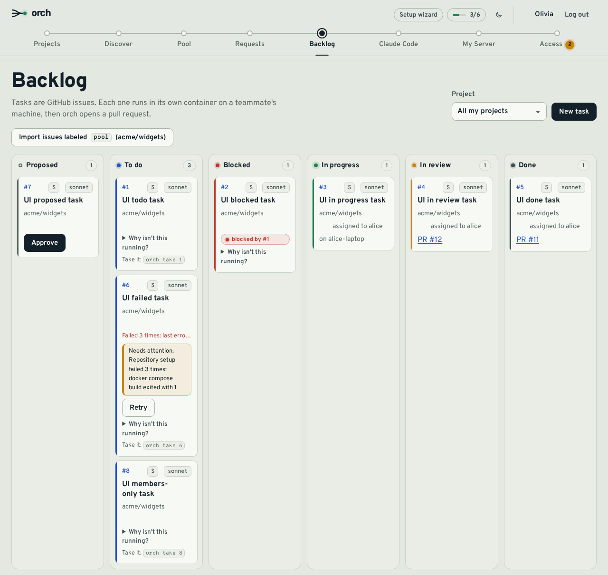
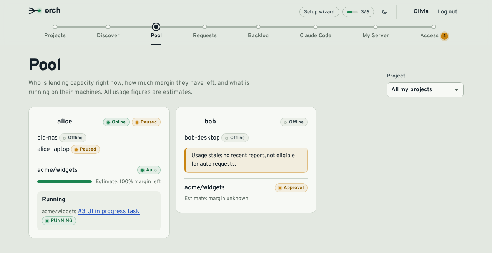

<div align="center">

# orch

**How do you hand a teammate's idle Claude capacity a to-do list, without ever sharing an account?**

[**orch.selfhostr.io**](https://orch.selfhostr.io) · [Docs](https://claude-orch.readthedocs.io) · [Source](https://github.com/Theroxat/claude_orch) · [Design notes](docs/PLAN.md) · [Deploy](#deploy-the-server)

[](https://claude-orch.readthedocs.io)


</div>



A shared to-do list for small, trusted teams, with automation on top. Tasks are GitHub issues. A member, or Claude Code through MCP, adds them to a shared pool. Each task then runs **on a teammate's own machine, with their own Claude subscription**, in a throwaway container that only sees its own git clone. orch pushes a branch and opens a PR.

- **No pooled accounts.** The server sees task statuses and usage estimates, never Claude credentials.
- **Outbound only.** Member machines connect to the server over a WebSocket; no inbound ports.
- **Docker everywhere.** Server, web, database, proxy, member agent, task sandboxes and every dev workflow.



Full documentation (quickstart, server installation, concepts, CLI and MCP reference, configuration, security model, FAQ) lives at **[claude-orch.readthedocs.io](https://claude-orch.readthedocs.io)**; its sources are in [`docs/`](docs/).

## Contents

[How it works](#how-it-works) · [Quick start](#quick-start) · [Deploy the server](#deploy-the-server) · [Operations](#operations) · [Daily use](#daily-use) · [MCP](#claude-code-mcp) · [Security model](#security-model) · [Development](#development) · [Limitations](#limitations)

## How it works

```
                         GitHub (App: OAuth, webhooks, issues, PRs)
                              ^  |
              REST + OAuth    |  | webhooks
                              |  v
 Browser ------ HTTPS ---->  +-------------------------------+      +----------+
 Claude Code -- /mcp ----->  |  Caddy (auto HTTPS, static    | ---> | server   | --- Postgres
                             |  web build, reverse proxy)    |      | (Fastify)|     (+ scheduled
 Member agents -- wss ---->  |  /api /mcp /agent/* /install.sh      +----------+      pg_dump)
   /agent/ws                 +-------------------------------+
        ^
        | outbound WebSocket only (no inbound ports on member machines)
        |
 +------+------------------- member machine (any Docker host) -------+
 |  agent container (docker.sock, ~/.claude read-only for usage)      |
 |    - mirrors + isolated clone per task                             |
 |    - `orch` CLI, `screen` sessions for manual mode                 |
 |    - starts, per task:                                             |
 |        task container: only the clone mounted, non-root, claude    |
 +--------------------------------------------------------------------+
```

| Piece      | What it does                                                                               |
| ---------- | ------------------------------------------------------------------------------------------ |
| `caddy`    | Automatic HTTPS for `ORCH_DOMAIN`, serves the web build, proxies the rest to the server    |
| `server`   | REST API, GitHub OAuth and webhooks, dispatcher, agent WebSocket gateway, MCP server       |
| `postgres` | All state. Internal network only                                                           |
| `backup`   | Scheduled `pg_dump` with rotation, optional age encryption and S3 upload                   |
| `agent`    | `ghcr.io/theroxat/orch-agent`: runs on each member's machine and drives their local Docker |

## Quick start

Server admin, once. Needs a Linux host with Docker 26+ and Compose, ports 80/443 and a DNS name. Full steps in [Deploy the server](#deploy-the-server).

```sh
git clone https://github.com/Theroxat/claude_orch.git && cd claude_orch/deploy/server
cp .env.example .env     # fill it in, then create the GitHub App
docker compose up -d
```

Each member, from the web UI (**My Server** gives you a one-time command, valid 15 minutes):

```sh
curl -fsSL https://<domain>/install.sh | ORCH_TOKEN=<one-time-token> sh   # installs the agent
orch login                                                                # links your Claude account, stored locally
```

Claude Code, to submit and inspect tasks from your editor:

```sh
claude mcp add --transport http --scope user orch https://<domain>/mcp
```

Then run `/mcp`, pick **orch**, **Authenticate**.

## Deploy the server

**1. DNS.** An `A` (and optionally `AAAA`) record for your domain, for example `orch.selfhostr.io`. It must resolve before the first start: Caddy requests the Let's Encrypt certificate then.

**2. Configure.** In `deploy/server`, copy `.env.example` to `.env` and generate the secrets:

```sh
openssl rand -hex 24      # POSTGRES_PASSWORD
openssl rand -base64 32   # ORCH_ENCRYPTION_KEY (back it up)
openssl rand -hex 32      # GITHUB_WEBHOOK_SECRET
```

| Variable                                                                       | Meaning                                                                 |
| ------------------------------------------------------------------------------ | ----------------------------------------------------------------------- |
| `ORCH_DOMAIN`                                                                  | Public host name                                                        |
| `POSTGRES_PASSWORD`                                                            | Database password                                                       |
| `ORCH_ENCRYPTION_KEY`                                                          | 32 random bytes, base64. Encrypts stored GitHub user tokens             |
| `GITHUB_APP_ID`, `GITHUB_APP_SLUG`, `GITHUB_CLIENT_ID`, `GITHUB_CLIENT_SECRET` | From your GitHub App (below)                                            |
| `GITHUB_WEBHOOK_SECRET`                                                        | Same value as the App's webhook secret                                  |
| `GITHUB_APP_PRIVATE_KEY_FILE`                                                  | Host path of the App private key (default `./secrets/github-app.pem`)   |
| `ORCH_ADMIN_GITHUB_LOGINS`                                                     | Admins (GitHub logins, comma-separated). They manage the Access page    |
| `ORCH_ALLOWED_GITHUB_LOGINS`, `ORCH_ALLOWED_GITHUB_ORGS`                       | Optional: who else may sign in (logins and/or organizations)            |
| `ORCH_ALLOW_ANY_GITHUB_USER`                                                   | `true` lets any GitHub account in. Only for a server that is not public |
| `ORCH_VERSION`                                                                 | Image tag of `orch-server` and `orch-web` (default `latest`)            |

In production the server **refuses to start** when nobody restricts sign-in (no admin, no allowlist, no approved access) unless `ORCH_ALLOW_ANY_GITHUB_USER=true`. All other variables (ports, TLS mode, proxy trust, access grace, backup schedule, log level) are documented in `.env.example`; scheduler knobs live in [`apps/server/src/config/index.ts`](apps/server/src/config/index.ts).

**3. Create the GitHub App** (GitHub, Settings, Developer settings, GitHub Apps, New). Replace `<domain>` with yours.

| Field                              | Value                                                                       |
| ---------------------------------- | --------------------------------------------------------------------------- |
| Homepage URL                       | `https://<domain>`                                                          |
| Callback URL                       | `https://<domain>/api/auth/github/callback`                                 |
| Request user authorization (OAuth) | Enabled                                                                     |
| Webhook URL and secret             | `https://<domain>/api/github/webhook`, the value of `GITHUB_WEBHOOK_SECRET` |
| Repository permissions             | Contents, Pull requests, Issues: read & write (Metadata: read-only)         |
| Organization permissions           | Members: read-only, only if you use `ORCH_ALLOWED_GITHUB_ORGS`              |
| Events                             | Issues, Pull request, Installation, Installation repositories               |

Copy the App ID and slug, generate a client secret, then generate a private key and save it as `deploy/server/secrets/github-app.pem`. It must exist before the first start and be readable by uid 1000 (`sudo chown 1000:1000 ... && chmod 400 ...`). Never commit it; `*.pem` is git-ignored. Because `Contents: write` can push to any branch, **enable branch protection** on your default branches: orch only pushes `orch/issue-<n>-*` and opens PRs.

**4. Start and check.**

```sh
docker compose up -d      # pulls ghcr.io/theroxat/orch-server and orch-web (or add --build)
curl -fsS https://<domain>/healthz     # {"status":"ok"}
```

Migrations run on every start. Upgrade with `git pull && docker compose pull && docker compose up -d`.

## Operations

**Access.** Admins get an **Access** page (`/admin/access`), no `.env` edit or restart needed. Someone not yet allowed signs in and lands on a "Request access" form; admins **Approve** or **Deny**. They can also pre-approve a login, create single-use or multi-use invite links (1 to 720 hours, stored hashed), or remove someone (sessions, tokens and agents are refused at once; nothing is deleted). Every decision is audited.

**Adding a member.**

1. Sign in at `https://<domain>` (request access if needed) and install the App on the repos to use. Owners register a repo as a project from **Projects**.
2. On **Discover**, join a project and choose `AUTO` (starts while you have budget) or `APPROVAL` (you accept each request), and which models you allow.
3. On **My Server**, copy the install command (see [Quick start](#quick-start)). It writes `~/orch/compose.yaml` and `~/orch/.env`, enrolls the machine, starts the agent and installs an `orch` shortcut in `~/.local/bin`. It is idempotent; `--uninstall [--purge]` removes it.
4. Run `orch login` (the installer offers it). The token stays in the agent's `orch-secrets` volume and is never sent to the server. If it expires, the agent refuses new AUTO offers until you log in again.

Agent settings live in `~/orch/.env` (`ORCH_PLAN` is `pro`, `max5` or `max20`); more options in [`apps/agent/src/config.ts`](apps/agent/src/config.ts).

**Updating agents.** The web app shows a banner when an agent is behind the server's release. **Update now** (or `orch update [--when-idle]`) makes the agent pull exactly `ghcr.io/theroxat/orch-agent:<version>`, switch over through a helper container and roll back on failure. It refuses while tasks run. Manual fallback: `cd ~/orch && docker compose pull && docker compose up -d`.

**Backups.** The `backup` service runs `pg_dump` on `BACKUP_SCHEDULE` (default every day at 03:00 UTC), keeps 7 daily, 4 weekly and 6 monthly dumps, and can encrypt them (age) and upload them to S3-compatible storage. Restore with `deploy/server/backup/restore.sh` (asks for confirmation, stops the server, restores in one transaction, restarts). Keep `.env` (notably `ORCH_ENCRYPTION_KEY`) and the App private key elsewhere: they are not in the dump. See [docs/backups.md](docs/backups.md).

<details>
<summary><b>Behind Cloudflare Tunnel</b></summary>

Cloudflare terminates TLS and `cloudflared` forwards plain HTTP to a local port; ports 80/443 are not used. In `.env`:

```sh
ORCH_DOMAIN=orch.selfhostr.io
ORCH_TLS_MODE=tunnel                      # default is acme
HTTP_PORT=8495                            # local port cloudflared connects to
ORCH_BIND_ADDR=127.0.0.1                  # keep the port off the LAN
HTTPS_PUBLISH=127.0.0.1:                  # nothing serves 443
ORCH_PUBLIC_URL=https://orch.selfhostr.io # always https
```

Point `cloudflared` ingress at `http://localhost:8495`. If it runs in Docker in another Compose project, use `deploy/server/compose.cloudflared.yaml` (`docker compose -f compose.yaml -f compose.cloudflared.yaml up -d`, service URL `http://orch-caddy:80`; Compose 2.24+). If `cloudflared` reaches the port from another host, set `ORCH_BIND_ADDR=0.0.0.0` and firewall the port so only it can connect, otherwise anyone could forge `X-Forwarded-For`.

Do not put Cloudflare Access in front of `/api/github/webhook`, `/agent/ws`, `/mcp`, `/.well-known/oauth-*`, `/api/oauth/*` or `/install.sh`: they authenticate themselves. WebSockets work by default; the 30 s agent heartbeat keeps them under Cloudflare's idle timeout.

</details>

## Daily use

**Web.** Issues carrying the project's pool label (default `pool`) become tasks. **Backlog** shows them by status, **Pool** shows teammates' availability (estimates), **Requests** lists approvals addressed to you. New tasks can also come from the Backlog page or MCP.

**CLI.** The `orch` shortcut runs these inside the agent container.

| Command                  | What it does                                                     |
| ------------------------ | ---------------------------------------------------------------- |
| `orch status`            | Agent connection, pause state, your tasks                        |
| `orch list [owner/repo]` | Tasks you can take now                                           |
| `orch take <n>`          | Claim issue `<n>` and prepare its sandbox (manual mode)          |
| `orch attach <n>`        | Attach to the Claude session of issue `<n>` (detach: `Ctrl-a d`) |
| `orch done <n>`          | Commit and push the branch; the server opens the PR              |
| `orch logs <n>`          | Follow the log of an auto run                                    |
| `orch requests`          | Approval requests waiting for you (`accept <id>`, `reject <id>`) |
| `orch pause` / `resume`  | Stop or restart receiving work                                   |
| `orch login`, `update`   | Store your Claude token, update the agent                        |

**Auto vs approval.** In `AUTO` the server offers a task to a member with enough estimated budget and the agent runs it headlessly; the PR opens as a **draft**. In `APPROVAL` nothing starts until you accept. You can always refuse locally with `orch pause`. Limits: 1 concurrent task per machine, 20 pending tasks per creator, timeouts of 30, 90 and 180 minutes for sizes S, M and L. The project owner merges the PRs.

## Claude Code (MCP)

The MCP server lets Claude Code see the pool and submit work. It needs no LLM key: your own Claude Code does the planning. Authentication is MCP OAuth 2.1 (PKCE, short-lived access tokens, rotating refresh tokens, all stored hashed and audited); the **Claude Code** page of the web UI shows the command and lets you revoke connected apps. For scripts and CI, create a personal access token there and pass `--header "Authorization: Bearer <orch_pat_token>"` to `claude mcp add`.

Tools: `view_pool`, `list_tasks`, `submit_task` (atomic batch with dependencies, supports dry runs), `take_task`, `task_status`. Example: "Read this repo, split the work to add CSV export into small tasks with acceptance criteria, and submit them to `acme/webapp` through orch. Dry run first."

## Security model

orch is for **small teams who trust each other**. It is a shared to-do list with automation, not a multi-tenant platform.

- **Trusted teams only.** Anyone who can get an issue labeled for the pool can, in effect, write a prompt that runs on a teammate's machine. Do not use orch with strangers or public repos where outsiders can file labeled issues.
- **Sandbox.** Each task runs in its own non-root container with only its own clone mounted: no Docker socket, no host home. Git metadata stays outside the container. A repo's own compose file is validated (no `privileged`, host mounts, Docker socket, host networking or `cap_add`); until that lands fully on the agent side, treat it as trusted code.
- **What the sandbox does not do.** In auto mode the agent runs `claude -p --permission-mode bypassPermissions` in a container that has **network access** and the member's Claude token. A malicious issue can make Claude exfiltrate that token or push harmful code to the task branch. There is no egress filtering in v1. The token is the member's own and revocable from their Claude account.
- **The agent is root-equivalent on the member's host** (it mounts `/var/run/docker.sock`). Rootless Docker reduces this.
- **Credentials stay local.** The Claude token lives in the agent's volume and that member's task containers. The agent mounts `~/.claude` read-only, only to estimate usage, which is approximate: treat budgets as hints.
- **Review PRs.** Auto-mode PRs are drafts. Enable branch protection and require human review.
- **Sign-in.** Admins and/or an allowlist of logins or organizations; everyone else needs approval. Org membership is checked with the user's own token. If GitHub is unreachable, the last decision is reused for `ORCH_ACCESS_GRACE_SEC` (default 900 s), then access fails closed. Removed users lose sessions, tokens and agents within minutes.
- **Server.** Only Caddy is published. GitHub user tokens are encrypted; agent credentials and MCP tokens are stored hashed. Webhooks are HMAC-verified and deduplicated. Caddy sends HSTS and a strict CSP, query strings are never logged, and every state change goes to an append-only audit log.

Report vulnerabilities privately through GitHub security advisories on this repository.

## Development

The host needs only `docker` with Compose and `sh`. `./dev` wraps `docker compose -f compose.dev.yaml`.

| Command                                | What it does                                             |
| -------------------------------------- | -------------------------------------------------------- |
| `./dev install`                        | `pnpm install` in the tools container                    |
| `./dev up` / `down` / `logs [service]` | Web at `localhost:8470`, API at `localhost:8471`         |
| `./dev lint` / `typecheck` / `build`   | Static checks and build                                  |
| `./dev test`                           | Unit and integration tests (shared, agent, web, server)  |
| `./dev test:ui`                        | Playwright UI suite on a seeded stack with a fake GitHub |
| `./dev test:install`                   | shellcheck and bats for `install.sh`                     |
| `./dev e2e`                            | End-to-end stack                                         |
| `./dev prisma <args>`                  | Prisma CLI                                               |

The first run copies `.env.example` to `.env`. GitHub sign-in needs a development GitHub App with callback `http://localhost:8470/api/auth/github/callback`. Migrations live in `apps/server/prisma/migrations/` (`YYYYMMDDHHMMSS_snake_name`); applied ones are immutable, never edit or rename them. CI runs lint, typecheck, tests, installer tests, image builds and gitleaks; a `v*` tag publishes `orch-server`, `orch-web` and `orch-agent` to `ghcr.io/theroxat`. Design and decisions: [docs/PLAN.md](docs/PLAN.md).

## Limitations

- Single server instance (in-process scheduler), no high availability; one host, scheduled dumps.
- No egress control, compose sanitizing or token-injecting proxy for task containers ([future hardening](docs/PLAN.md#11-future-hardening-if-pools-ever-open-to-untrusted-members)).
- Usage and budget are estimates; plans are declared by the member.
- Repos must build from a `Dockerfile` or a simple `.devcontainer.json`.
- Manual-mode `screen` sessions end if the agent container restarts; `orch attach <n>` reopens one.
- GitHub only, English UI only.
- Images run TypeScript through `tsx` rather than a compiled build, and the server image weighs about 380 MB (Alpine, trimmed Prisma CLI).

## License

MIT. See [LICENSE](LICENSE).
