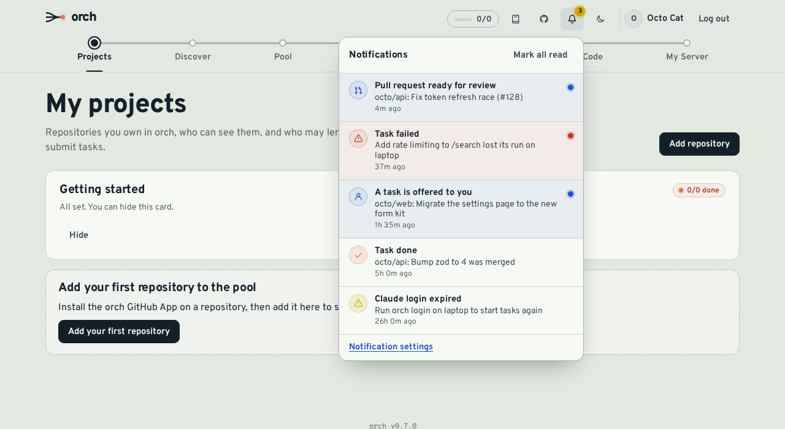
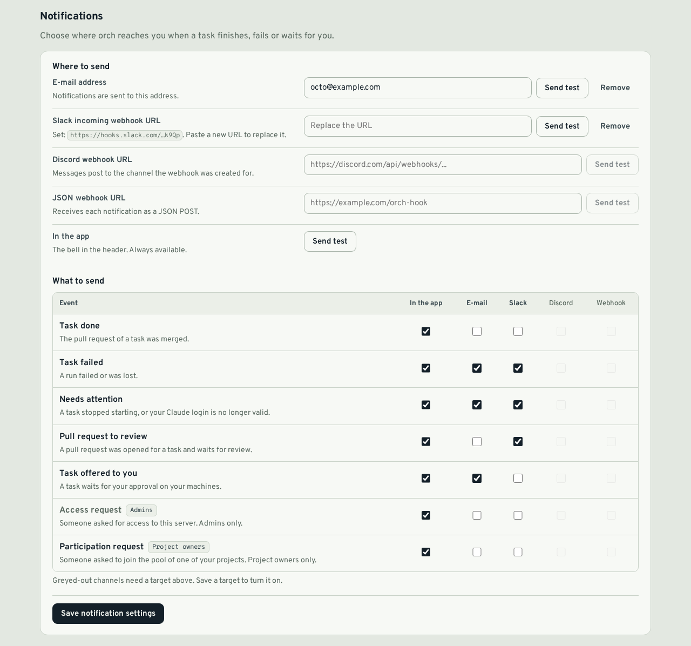

# Notifications

orch tells you when something needs you: a task you created is merged or fails, a PR waits for review, a task is offered to you, or someone asks to join your pool or your server. Notifications show up in the app (the bell in the header) and, if you want, in your browser, in Slack, Discord, any JSON webhook or by e-mail.



## Events

| Event                     | Sent to                                           | When                                                                                 |
| ------------------------- | ------------------------------------------------- | ------------------------------------------------------------------------------------ |
| **Task done**             | The task's creator and the member who ran it      | The task's PR is merged                                                              |
| **Task failed**           | The creator and the member whose machine ran it   | A run fails, produces no changes, or is lost (the agent stopped reporting)           |
| **Needs attention**       | The creator and the project owner                 | A task stops being dispatched after repeated setup (`env`) failures                  |
|                           | The agent's owner                                 | Claude rejects the login of one of your agents (run `orch login` on that machine)    |
| **PR ready for review**   | The project owner and the creator                 | orch opens the PR of a task, or someone opens a PR on a task branch                  |
| **Task offered to you**   | The member it is offered to                       | A consent request (`APPROVAL` mode) waits for your answer                            |
| **Access request**        | Admins (`ORCH_ADMIN_GITHUB_LOGINS`) who signed in | Someone asks for access to the server                                                |
| **Participation request** | The project owner                                 | Someone asks to join the pool of a project that requires approval (once per request) |

You are never notified about something you did yourself in the web app (for example, approving your own request).

## Channels

Set them up on **My Server → Notifications**, then choose, per event, which channels it goes to. By default every event goes to the app only. Each channel has a **Send test** button that sends one message right away and shows the result.



| Channel | What you enter                                                                                     |
| ------- | -------------------------------------------------------------------------------------------------- |
| In-app  | Nothing. The bell shows the unread count; notifications are kept 90 days (`NOTIFY_RETENTION_DAYS`) |
| E-mail  | An address. Only offered when the server has SMTP settings (see below)                             |
| Slack   | A Slack [incoming webhook](https://api.slack.com/messaging/webhooks) URL. Mattermost works too     |
| Discord | A channel [webhook](https://support.discord.com/hc/en-us/articles/228383668) URL                   |
| Webhook | Any `https` URL that accepts a JSON `POST`                                                         |
| Browser | Nothing to type: switch on **Enable browser notifications** in each browser you want (see below)   |

Webhook URLs are secrets (anyone who has one can post to your channel). orch stores them encrypted with `ORCH_ENCRYPTION_KEY` and only ever shows a masked hint such as `https://hooks.slack.com/…k9Qp`. To change one, paste a new URL; **Remove** deletes it.

### Generic webhook payload

```json
{
  "version": 1,
  "id": "cm3…",
  "event": "task_failed",
  "title": "Run failed: Add rate limiting to /search",
  "body": "acme/api#42: tests failed. The task went back to the pool.",
  "url": "https://orch.example.com/backlog?task=cm2…",
  "projectId": "cm1…",
  "taskId": "cm2…",
  "createdAt": "2026-10-22T09:14:03.120Z"
}
```

`event` is one of `task_done`, `task_failed`, `task_needs_attention`, `pr_review`, `consent_request`, `access_request`, `participation_request`. `url` is the PR for `task_done` and `pr_review`, otherwise a page of the web app. Any `2xx` answer counts as delivered; redirects are not followed.

## Browser notifications

With browser notifications (Web Push), orch shows a system notification on your computer or phone, even when orch is not open. Clicking it opens the related page of the app.

1. On **My Server → Notifications**, switch on **Enable browser notifications** and allow notifications when the browser asks.
2. In the table below, tick **Browser** for the events you want. Without a tick, nothing is sent.
3. Use **Send test** to check.

It is set up per browser: repeat step 1 on each device you want (up to 10 per member; the oldest is dropped beyond that). Switching the toggle off, or removing the site permission in the browser, stops notifications on that browser.

- **iPhone and iPad** only support Web Push for apps added to the Home Screen: install orch first ({doc}`usage`, "Install as an app").
- If you blocked notifications for the site earlier, the browser will not ask again: allow them in the browser's site settings.
- A browser that was uninstalled or that revoked the permission is detected on the next delivery (the push service answers `404` or `410`) and forgotten automatically.

### Server setup

The server needs a VAPID key pair, which identifies it to the browsers' push services. Generate it once and add it to `deploy/server/.env`:

```sh
npx web-push generate-vapid-keys
```

```sh
VAPID_PUBLIC_KEY=B...
VAPID_PRIVATE_KEY=...
VAPID_SUBJECT=mailto:admin@example.com   # or an https:// URL
```

Restart the server. Without these variables the **Browser** column is greyed out. Keep the pair: browsers are subscribed to the public key, so replacing it requires every member to switch the toggle off and on again.

Messages travel through the browser vendor's push service (Google, Mozilla, Apple or Microsoft), encrypted so that only the target browser can read them. They contain the title and the first lines of the text, like the other external channels. The server only accepts subscription addresses of these services (`https`, known hosts), and delivery uses the same private-network guard as webhooks (see below). Pushes are retried like other deliveries and expire after 24 hours if the browser stays offline.

## Delivery

Notifications never slow down the action that caused them: they are prepared in the background after the action is recorded in the audit log. External deliveries are retried on network errors, timeouts (10 s), `408`, `429` and `5xx` answers, with exponential backoff (2 s, 8 s, 32 s by default, `NOTIFY_MAX_ATTEMPTS` attempts in total). Other `4xx` answers (for example a deleted Slack hook) stop at once. Failures are written to the server log with the channel and the user, never the URL.

Retries are kept in memory: a server restart drops deliveries still waiting for a retry. In-app notifications are written to the database first and are not affected.

## Security: no requests to private networks

A webhook URL is chosen by a member, so the server checks it to make sure it cannot be used to reach machines on its own network (SSRF):

- only `https` URLs without credentials are accepted;
- host names such as `localhost`, `*.local`, `*.internal` or single-label names are refused, and so are IP addresses in private, loopback, link-local (including cloud metadata `169.254.169.254`), carrier-grade NAT, multicast and reserved ranges, IPv4 and IPv6 (including IPv4-mapped forms);
- the check is repeated at delivery on every address the name resolves to, and the connection goes to the checked address, so a DNS answer that changes after the check cannot point the request inside.

A consequence: a Slack-compatible server on your LAN (for example a self-hosted Mattermost on a private IP) cannot be used as a webhook target.

## E-mail (SMTP)

E-mail is optional. Set these in `deploy/server/.env` and restart the server:

```sh
SMTP_HOST=smtp.example.com
SMTP_PORT=587          # 465 with SMTP_SECURE=true
SMTP_SECURE=false      # true: TLS from the first byte; false: STARTTLS when offered
SMTP_USER=orch@example.com
SMTP_PASSWORD=...
SMTP_FROM="orch <orch@example.com>"
```

Without `SMTP_HOST` the e-mail column is greyed out in the settings. A permanent SMTP refusal (`5xx`, for example an unknown address) is not retried.

See {doc}`configuration` for every variable.
